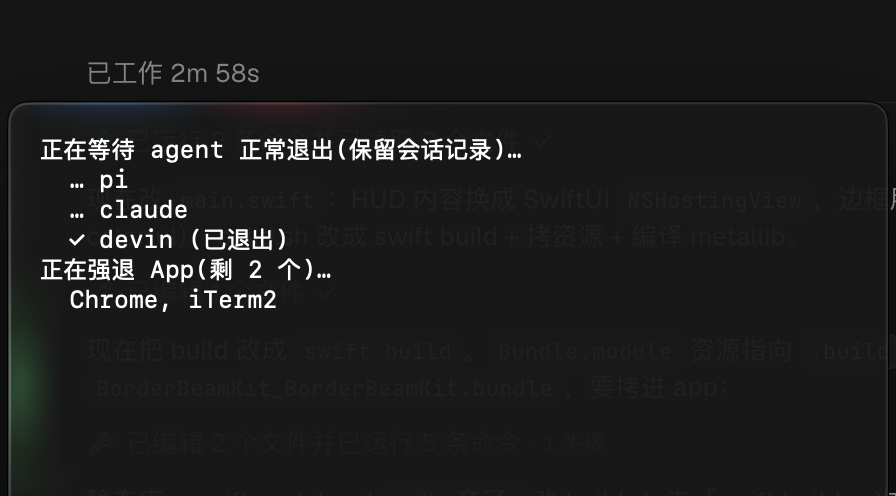

<div align="center">


# OneShutdown

**Shut down your Mac in one click, even when apps keep asking "Are you sure?"**

[](https://github.com/ZephyrDeng/one-shutdown/releases/latest)
[](#install)
[](#install)
[](https://github.com/ZephyrDeng/one-shutdown/releases/latest)
[](Sources/main.swift)
[](LICENSE)

English · [简体中文](README.zh-CN.md)


</div>

## The problem

It's 6:30 pm. You hit **Apple menu → Shut Down**, close the lid on the day, and walk out.

The next morning the Mac is still on, because macOS lets any app cancel a shutdown:

- **Terminal / iTerm / Warp:** *"Do you want to terminate running processes?"*
- **Editors:** *"Do you want to save the changes you made to 'Untitled'?"*
- **Browsers:** *"Quit Chrome? You have 47 tabs open."*
- **Docker, OrbStack, IDEs, chat apps:** something always has an opinion.

One dialog is enough to cancel the whole shutdown, and you won't see it until you come back.

## Who it's for

OneShutdown is for you if you **turn your Mac off every day** and already know you've saved what matters:

- 🎒 **You carry a Mac mini or MacBook** between office and home every day (that's why this exists)
- 👩‍💻 **You're a developer**: dev servers in terminals, containers and 40-tab browsers, all of which can block shutdown
- 🏢 **You power off a shared or office Mac** at the end of the day, for security or energy rules

If you mostly put your Mac to sleep, or you rely on those *"Save changes?"* prompts as a safety net, this isn't for you.

## How it works

Click the <kbd>⏻</kbd> icon in the menu bar → **Shut Down Now**. That's it.

1. AI agents still running (Claude, Codex, pi, devin, cursor-agent, …) get a **SIGTERM** first — they flush their session logs, so you can resume them next time instead of finding a truncated history.
2. Every regular app (anything with a Dock icon) is **force-quit**, so no app gets a chance to ask a question.
3. One second later, macOS shuts down normally.

The status menu shows how many agent sessions are running before you commit. Once you confirm, a center-screen HUD tracks the shutdown live — each agent's graceful exit, then the apps being force-quit — ringed by a rotating [BorderBeam](https://github.com/xxvzzczxxl/border-beam) glow.



Finder, background services and menu-bar utilities are left alone and quit as part of the regular shutdown.

|  | Apple menu → Shut Down | `sudo shutdown -h now` | **OneShutdown** |
|---|:---:|:---:|:---:|
| Apps can cancel it with dialogs | ❌ yes | ✅ no | ✅ no |
| Needs Terminal + admin password | ✅ no | ❌ yes | ✅ no |
| Steps | 2 clicks + 1 per dialog | open Terminal, type, password | **1 click** |

> [!WARNING]
> **Unsaved work is discarded. That's the whole point.** Save what matters first. Browsers and editors with session restore (Chrome, VS Code, …) usually reopen where you left off.

## Install

1. Download **`OneShutdown.zip`** from the [latest release](https://github.com/ZephyrDeng/one-shutdown/releases/latest), unzip it, and drag `OneShutdown.app` into `/Applications`.
2. Open it. A power icon appears in the menu bar. No Dock icon, no window.
3. *(Optional)* Start it at login: **System Settings → General → Login Items → +** → pick OneShutdown.

<details>
<summary><b>macOS asks to let OneShutdown control "System Events"</b></summary>

Click **Allow**. OneShutdown asks System Events to shut down the Mac, the same way the Apple menu does. No sudo, no password. If you clicked *Don't Allow*, turn it back on in **System Settings → Privacy & Security → Automation**.

</details>

## Build from source

No Xcode project and no dependencies, just the `swiftc` that ships with the Command Line Tools:

```bash
git clone https://github.com/ZephyrDeng/one-shutdown.git
cd one-shutdown
./build.sh                 # → build/OneShutdown.app (universal, macOS 14+)
open build/OneShutdown.app
```

The app itself is [287 lines of Swift](Sources/main.swift); the beam animation comes from the vendored [BorderBeamKit](Packages/BorderBeamKit/) package (SwiftUI + Metal shaders). Read it before you run it.

## Ideas & contributing

Issues and PRs are welcome. Some directions people may want:

- [ ] Global hotkey
- [ ] Restart / Log Out variants
- [ ] An "always spare these apps" list
- [x] Wait for AI agent sessions to flush logs (v2.0)

## License

[MIT](LICENSE) © Zephyr Deng

<div align="center">

**If OneShutdown got you out the door faster today, a ⭐ helps other people find it.**

</div>
