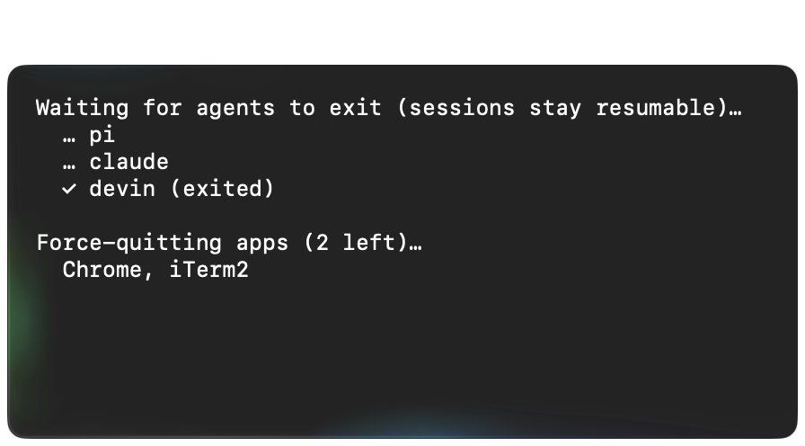

<div align="center">


# OneShutdown

**Mac 一键关机，就算 App 一直弹「确定要退出吗？」也照样关。**

[](https://github.com/ZephyrDeng/one-shutdown/releases/latest)
[](#安装)
[](#安装)
[](https://github.com/ZephyrDeng/one-shutdown/releases/latest)
[](Sources/main.swift)
[](LICENSE)

[English](README.md) · 简体中文



</div>

## 痛点

下班了，点「 → 关机」，收拾东西走人。

第二天回来发现 Mac 根本没关，因为 macOS 允许任何一个 App 取消关机：

- **终端 / iTerm / Warp**：「是否终止正在运行的进程？」
- **编辑器**：「是否保存对『未命名』的更改？」
- **浏览器**：「退出 Chrome？你打开了 47 个标签页。」
- **Docker、OrbStack、IDE、聊天软件**：总有一个要插话。

只要弹出一个窗口，整次关机就作废了，而你人已经走了，根本看不到。

## 适合谁

如果你**每天都要关机**，而且关之前心里清楚该保存的都已经保存了，那 OneShutdown 就是为你做的：

- 🎒 **每天带着 Mac mini / MacBook 上下班**（这个工具就是这么来的）
- 👩‍💻 **开发者**：终端里跑着 dev server、容器、几十个标签页，个个都能拦住关机
- 🏢 **下班要关掉公司或共用的 Mac**：安全规定或节能要求

如果你平时只是让 Mac 睡眠，或者指望「是否保存」弹窗帮你兜底，那这个工具不适合你。

## 原理

点菜单栏 <kbd>⏻</kbd> → **立即关机**，就这样。

1. **先收 agent。** 还在运行的 AI harness（Claude、Codex、pi、devin、cursor-agent、opencode……）收到 `SIGTERM`，最多 5 秒把会话记录写完落盘——下次 `--resume` 接着跑，而不是留下半截历史。
2. **再强退 App。** 所有普通 App（Dock 里有图标的）被强制退出，不给「是否保存」弹窗的机会。
3. **正常关机。** 走 macOS 标准关机流程。

菜单第一行实时显示还有几个 agent 会话在跑；确认后屏幕中央弹出 HUD，逐个跟踪 agent 的退出和 App 的强退，外圈绕着一圈旋转的 [BorderBeam](https://github.com/xxvzzczxxl/border-beam) 流光。按住 ⌥ 点菜单栏图标可以看演示。

Finder、后台服务和菜单栏小工具不会被强退，它们在系统关机时正常退出。

|  | 菜单 → 关机 | `sudo shutdown -h now` | **OneShutdown** |
|---|:---:|:---:|:---:|
| 会被 App 弹窗拦住 | ❌ 会 | ✅ 不会 | ✅ 不会 |
| AI agent 会话可 resume | ❌ 写到一半被杀 | ❌ 写到一半被杀 | ✅ SIGTERM + 宽限 |
| 需要开终端 + 输管理员密码 | ✅ 不需要 | ❌ 需要 | ✅ 不需要 |
| 操作步骤 | 点 2 下，每个弹窗再点一下 | 开终端、敲命令、输密码 | **点 1 下** |

> [!WARNING]
> **未保存的内容会直接丢掉，这个工具就是为此设计的。** 重要内容请先保存。Chrome、VS Code 这类带会话恢复的 App，下次打开一般会回到原来的状态。

## 安装

1. 从 [最新 Release](https://github.com/ZephyrDeng/one-shutdown/releases/latest) 下载 **`OneShutdown.zip`**，解压后把 `OneShutdown.app` 拖进「应用程序」。
2. 打开后，菜单栏会出现电源图标。没有 Dock 图标，也没有窗口。
3. （可选）开机自启：**系统设置 → 通用 → 登录项 → +** → 选择 OneShutdown。

<details>
<summary><b>系统询问是否允许 OneShutdown 控制「System Events」</b></summary>

点 **允许**。OneShutdown 通过 System Events 关机，和苹果菜单里的「关机」是同一个流程，不需要 sudo，也不用输密码。如果点了「不允许」，可以去 **系统设置 → 隐私与安全性 → 自动化** 重新打开。

</details>

## 从源码构建

不需要 Xcode 工程，也没有任何依赖，Command Line Tools 自带的 `swiftc` 就够了：

```bash
git clone https://github.com/ZephyrDeng/one-shutdown.git
cd one-shutdown
./build.sh                 # → build/OneShutdown.app（通用二进制，macOS 14+）
open build/OneShutdown.app
```

App 本体是 [287 行 Swift](Sources/main.swift)，光束动画来自内置的 [BorderBeamKit](Packages/BorderBeamKit/) 包（SwiftUI + Metal shader，移植自 border-beam 网页库）。运行前可以先读一遍。

## 想法与贡献

欢迎提 Issue 和 PR。下面这些方向可能有人需要：

- [ ] 全局快捷键
- [ ] 重启 / 注销
- [ ] 「这些 App 不要强退」白名单
- [x] 等 AI agent 会话写完记录再关机（v2.0）

## License

[MIT](LICENSE) © Zephyr Deng

<div align="center">

**如果 OneShutdown 让你今天早走了一会儿，点个 ⭐ 能让更多人看到它。**

</div>
